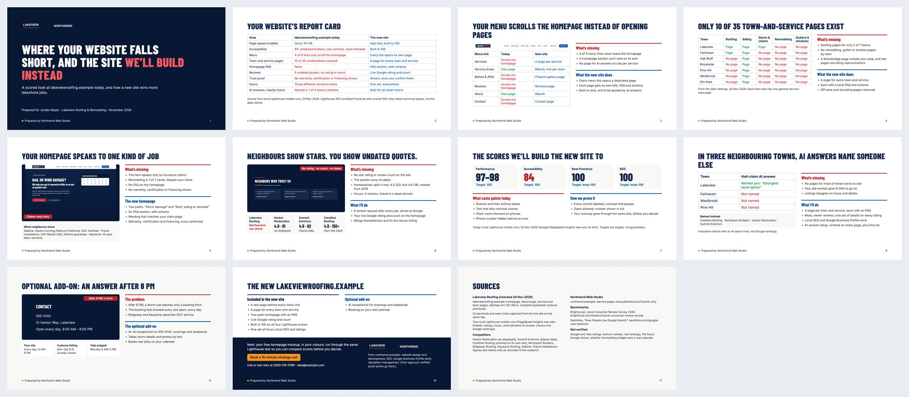
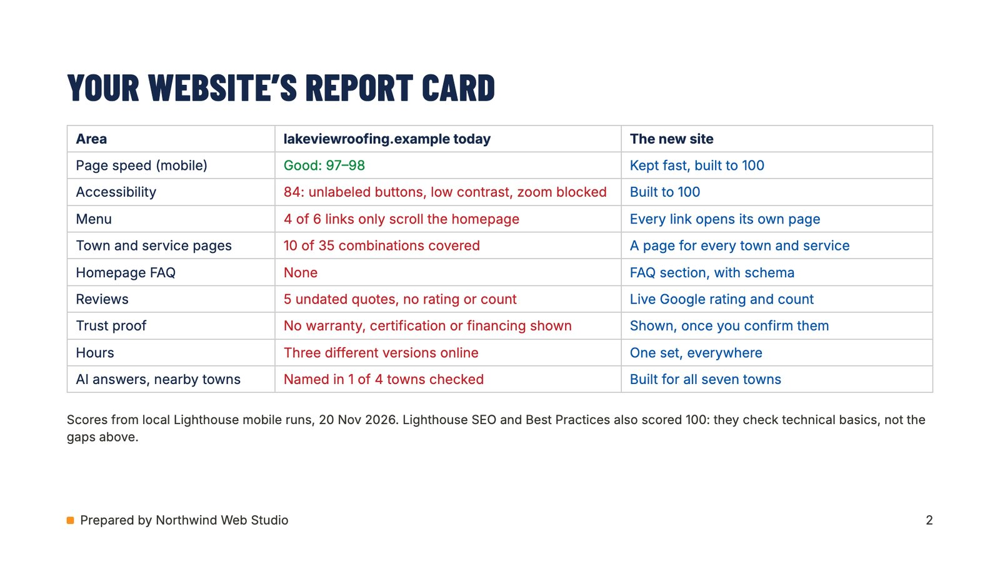
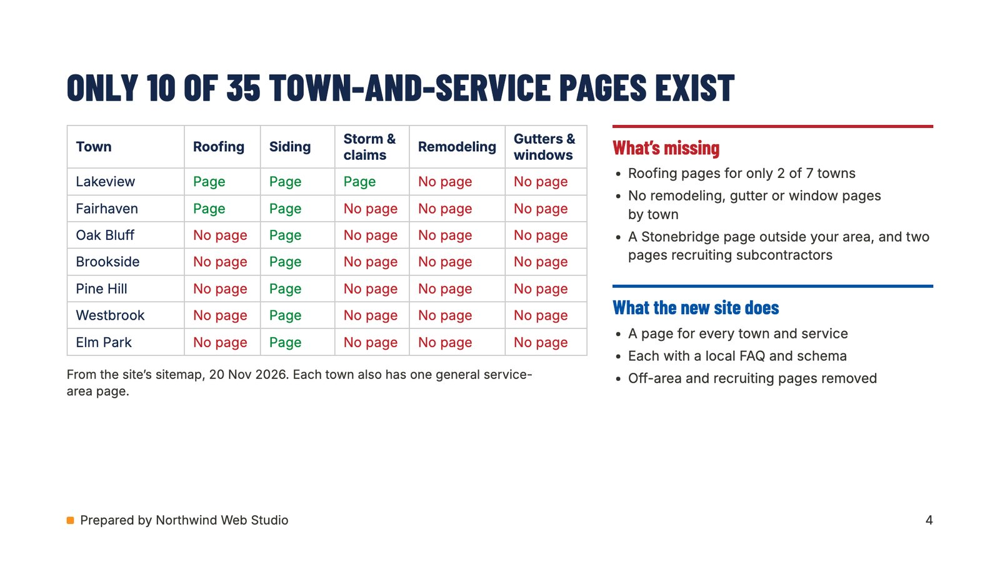
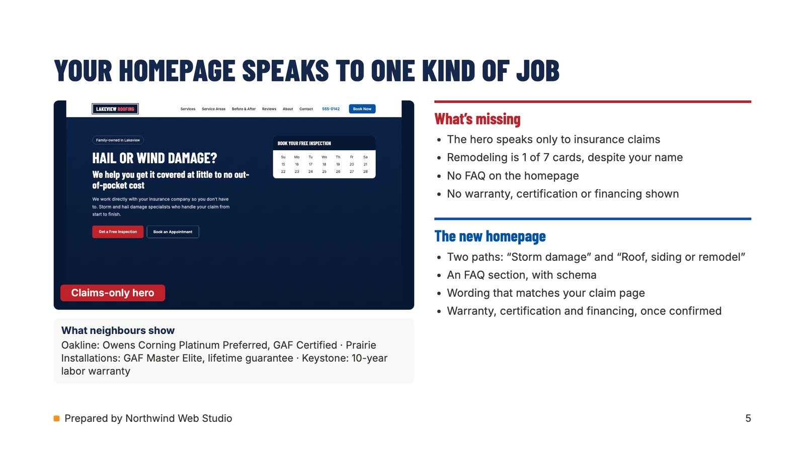
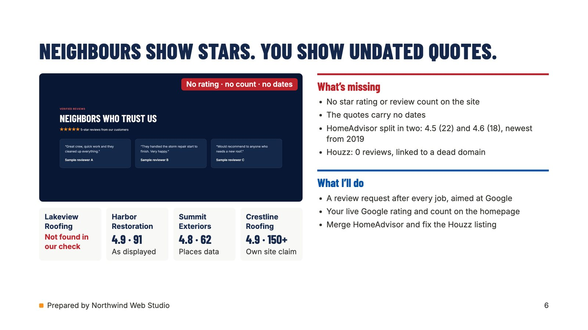
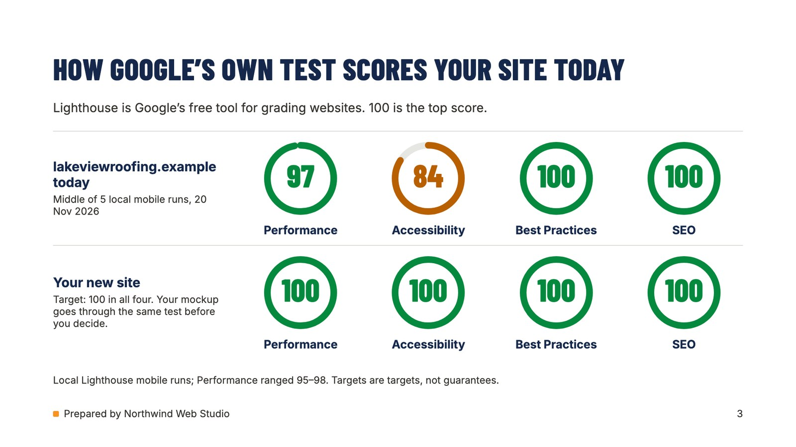
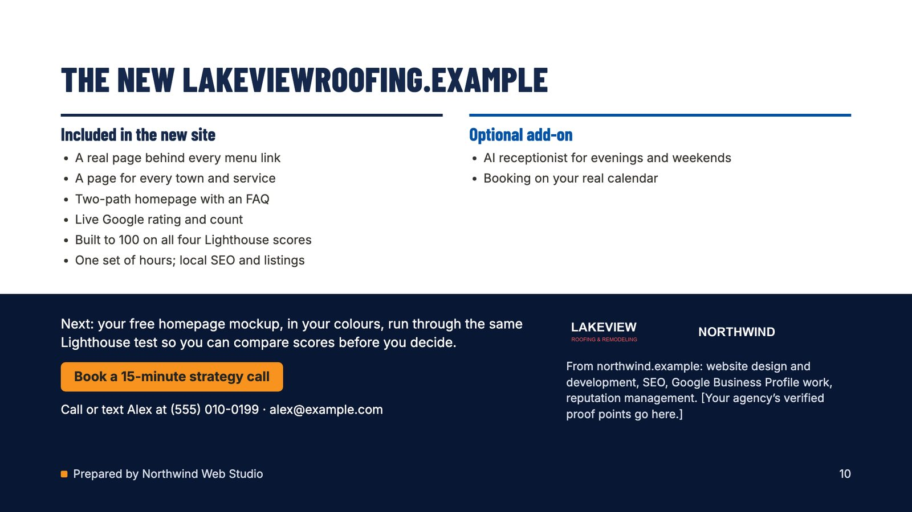

# website-pitch-deck

**Send Claude a prospect's URL. Get back a sales deck built from their own website.**

A [Claude Code](https://claude.com/claude-code) skill for web agencies. It audits a local business's live website, captures real screenshots, scores what it finds, and builds an 11-slide pitch deck: where the site falls short, what the new site does about each gap, and a clear next step. Every number on a slide traces back to something checked on the live site.



<sub>The example deck is for a **fictional** roofing company. Every business, town and number in it is made up.</sub>

---

## What one URL turns into

| | |
|---|---|
|  |  |
| **A report card.** Nine areas, today vs. the new site. One honest "pass" where the site really is good, so the critique holds up. | **A coverage grid.** Built from the prospect's own `sitemap.xml`: which town-and-service pages exist, and which don't. |
|  |  |
| **Their own screenshots, annotated.** Captured from the live site, never mocked up, with a red flag on the problem. | **Competitors, with sources.** Every third-party rating is labelled "as displayed", "places data" or "own site claim". |
|  |  |
| **Scores with a proof plan.** Lighthouse today vs. a stated target, plus a promise to run the mockup through the same test. | **A clean close.** What's included, what's optional, the next step and one call-to-action. |

## What the skill does

1. **Researches the live site.** It checks:
   - which menu links are real pages and which only scroll the homepage
   - which town × service pages exist, from the sitemap
   - FAQ and schema, the reviews block, booking widgets, hours, trust proof
   - brand colours and fonts from the compiled CSS
   - Lighthouse scores, listings, competitors, and indicative AI-answer checks
2. **Captures evidence.** Headless Chrome screenshots of the hero, the mobile header, the reviews block and the footer hours, cropped to the exact section (`scripts/cdp-shot.mjs`).
3. **Takes notes in any form.** Typed notes, or voice notes transcribed locally with whisper.cpp. Promises already made to the prospect end up in the deck.
4. **Builds the deck in the prospect's own brand:** their colours, their fonts, their logo. Your agency's accent appears only on the footer mark and the call-to-action.
5. **Checks its own work.** It renders every slide locally (`scripts/render_check.py`) and fixes overflow before anything is published.
6. **Writes speaker notes** for every slide: the evidence, why it costs calls, what changes, and what to ask the owner.

**No website yet?** Give it the business's Facebook page or listing instead. It switches to a first-website pitch:
- what a stranger sees on their social page
- who shows up when people search their towns
- a coverage grid of pages that don't exist yet
- if a homepage mockup is already built, its measured Lighthouse scores

## Honest by design

A pitch deck that overclaims gets caught in the first meeting. These rules are built into the skill:

- **No invented facts.** Never invents ratings, reviews, certifications, warranties or results. If something wasn't found, the slide says "Not found in our check".
- **Labelled sources.** Every third-party number carries its source, and AI-answer checks are marked "indicative, not Google rankings".
- **Targets are targets.** No promised rankings, review counts or call volumes, and no pricing or lost-revenue maths.
- **No quoting the agency's own marketing.** Agency proof comes only from claims the agency publishes and lists in its config.
- **Unverified stays off the slides.** Anything unconfirmed goes in the speaker notes and on the sources slide, never on a slide as fact.

## Install

```bash
git clone https://github.com/prx-my/website-pitch-deck ~/.claude/skills/website-pitch-deck
cd ~/.claude/skills/website-pitch-deck
cp agency.example.md agency.md   # then fill in your agency's details
```

`agency.md` is git-ignored, so your name, contact details and proof points stay on your machine.

## Use

In Claude Code:

```
/website-pitch-deck https://prospect-site.com
```

or just say *"make a pitch deck for https://prospect-site.com"* and attach any notes or voice memos about the prospect.

## Requirements

- **Claude Code.** With Artifacts enabled, the deck publishes as a Slides artifact you can present, share or download as PDF/PPTX. Without it, the same HTML renders to PNG/PDF with `scripts/render_check.py`.
- **Google Chrome or Chromium**, for screenshots and render checks. Set `CHROME=/path/to/chrome` if it isn't in the macOS default location.
- **Node 22+**, for `cdp-shot.mjs`, which uses the built-in `WebSocket`.
- **Python 3 with Pillow**, for cropping and contact sheets.
- **Optional:** `ffmpeg` + `whisper-cli` (whisper.cpp) for voice notes, and Lighthouse.

## Repo layout

```
SKILL.md              the playbook Claude follows
agency.example.md     template for your private agency.md
reference/            finished example deck: deck.json, deck.css, slides/*.html
scripts/cdp-shot.mjs  section screenshots over the Chrome DevTools Protocol
scripts/render_check.py  local render + contact sheets for overflow checks
examples/             fictional site and assets used to render the example
docs/                 the images in this README
```

Try the render check on the example:

```bash
mkdir -p /tmp/example/project && cp -R reference/* /tmp/example/project/
python3 scripts/render_check.py /tmp/example examples/blobs.json /tmp/example/out
```

## License

MIT. See [LICENSE](LICENSE).
